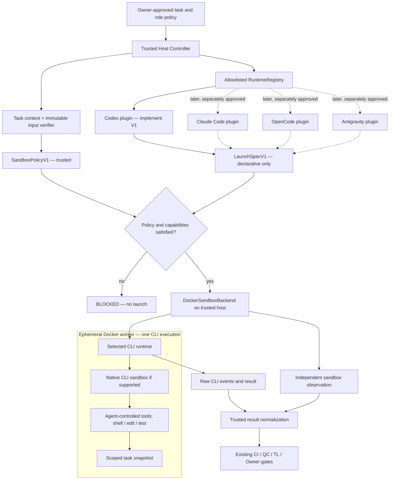
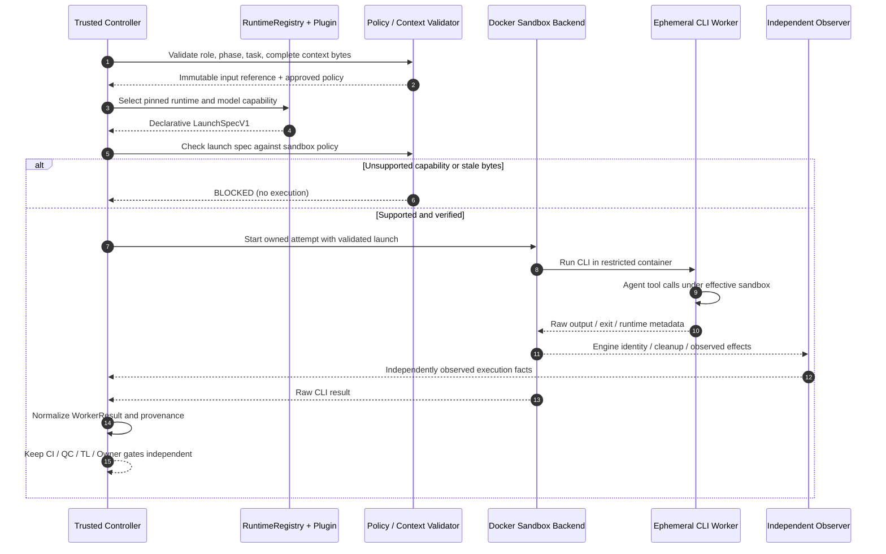
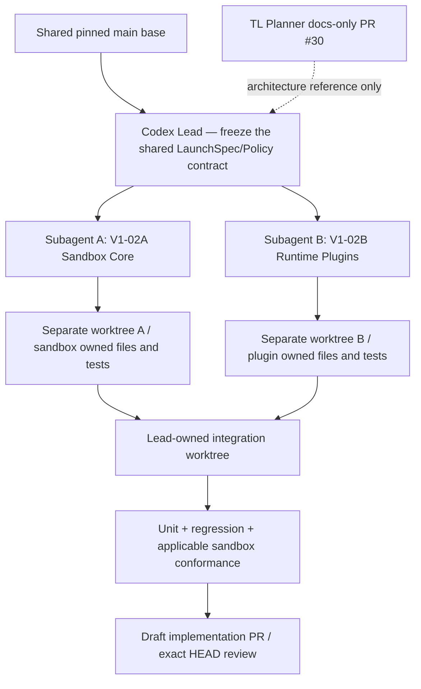

# ADR — Universal Agent Sandbox & Runtime Plugin Foundation (V1 proposal)

**Status:** PROPOSED — Owner direction accepted for a new foundation effort; design/implementation and security evidence not yet reviewed or approved for merge.
**Date:** 2026-11-09
**Baseline:** `builacviet/agent-workflow` `main@96f5d523814f94ebfec244c66e38d400e2144509`
**Related:** [V1 scope/gates](../v1-scope-and-gates.md), [CURRENT architecture](../architecture.md), [V1-02 blocked Plan v1.2](https://github.com/builacviet/agent-workflow/pull/29), [V1-02 QC MTP v0.4](https://github.com/builacviet/agent-workflow/pull/28)

## Context and decision

We want a **vendor-neutral contract**, not an implementation hardwired to Codex's sandbox. Three independent dimensions:
1. **CLI runtime plugin** (`codex-cli` first, potential Claude Code, OpenCode, Antigravity/AGY and more later): CLI startup, instruction delivery, supported tool/approval mapping, parsing, and runtime capabilities.
2. **Model provider / model / reasoning profile**: validated against that runtime's explicitly pinned support catalog; a provider is not the runtime or the sandbox.
3. **Sandbox backend / policy**: common *trusted host Controller → Docker CLI* in V1, with an ephemeral Docker worker for each approved invocation. Per-CLI native OS sandbox may provide defense in depth but is **not the universal security boundary**.

Composition: `Controller → trusted RolePolicy & TaskContext → RuntimeRegistry → approved RuntimePlugin → SandboxPolicy validator / DockerSandboxBackend → independent SandboxObservation → normalized WorkerResult`.

No arbitrary plugin auto-install or unsigned configuration/skill/hooks loaded from an agent-controlled checkout. New CLI installation is not automatically enabled: `register → capability validation → conformance → trusted enable`. CLI-specific image is permitted; one universal image is not required.

## Architecture diagrams (PROPOSED, not implemented)

These Mermaid diagrams render in GitHub. They show the target V1 foundation **after implementation and validation**, not an already verified deployment. The trusted host Controller still calls the existing Docker CLI; no new Executor or parallel production dispatch is introduced.

### A. Components and plugin boundaries

**Boundary:** A runtime plugin chooses its compatible invocation format, but **cannot create Docker grants or override the trusted SandboxPolicy**. Native CLI sandbox differs by vendor and is defense in depth. Dashed plugins are **future targets**, not installed/supported V1 implementations. The dotted plugin-to-LaunchSpec lines are future adapter paths, not execution in parallel.

### B. Execution and evidence flow

**Unresolved V1-02 P0 proofs:** (1) agent tool can perform a benign action but **cannot read/export same-role authentication**; (2) actual CLI consumes the exact **verified context bytes after the last check**, not a changed path; (3) model/effort evidence must distinguish requested/thread/turn settings from independently proven provider-effective inference. Until proven, these claims remain `BLOCKED` or `UNVERIFIED`, never passed merely from diagrams, mocks or CI.

### C. Two coding subagents without overlapping files

Two subagents parallelize **development worktrees only**. V1 production Controller dispatch stays sequential per [scope and gate contract](../v1-scope-and-gates.md). Integration and any edits to existing shared runner/Controller files are **Lead-owned**.

## Minimal common interfaces (design contract, not existing source)

**SandboxPolicy v1** (trusted input): `policy_version`, `role`, `phase`, `task_id`, `attempt_id`, `source_snapshot_id`, `allowed_read_roots`, `allowed_write_roots`, `workspace_root`, `network_mode` (`none` or explicitly constrained approved egress), `process_limits` (duration, memory, CPU, PID), `credential_mode`, `required_capabilities`, `backend_id`, and immutable image identifier. Unknown fields/values, wider agent-supplied grants, ambiguous paths, unsupported backend capabilities: **fail closed**.

**RuntimePlugin v1**: declare `runtime_id`, pinned version and image, supported providers/model/reasoning, tool/sandbox capabilities, credential mode, instruction delivery type, result/telemetry mapping. Implement `validate`, `prepare`, `build_launch_spec`, and `normalize` (names illustrative; Lead freezes exact signatures before parallel implementation). Plugin returns **declarative launch request**, not raw Docker control or authorization.

**SandboxBackend v1**: accept a trusted, already validated sandbox request, build fixed Docker flags/mounts/limits, run in an owned disposable attempt and independently report `SandboxObservation` (exit/timeout/cleanup/observable effects). `WorkerResult` is normalized by the trusted runtime layer and **cannot approve its own CI, QC, TL, Owner or merge gate**.

**Integration seam:** Runtime plugin emits `LaunchSpecV1` (argv, approved image/runtime pin, working directory, logical workspace and explicit nonsecret configuration references). Sandbox backend owns host path resolution, allowed mounts, security options, resource limits, network and lifecycle. A plugin cannot relax policy; no direct Docker socket/control is given to worker. If invocation cannot satisfy requested role capabilities, mark `BLOCKED`, not fallback.

## Shared controls and security realities

- Reuse CURRENT Phase 3.1 trusted host Docker runner. Non-root UID, read-only root filesystem where feasible, dropped capabilities, no-new-privileges, bounded PIDs/CPU/RAM/time, stage snapshot, explicit mounted paths, ownership-aware cleanup. An OS-level sandbox in a CLI is optional defense in depth, never assumed equivalent across vendors. Test compatibility with Docker/WSL2 before claiming enforcement.
- **Credential isolation remains an unresolved P0 for V1-02**: Docker isolates *container from host*; it does **not** hide a mounted `auth.json` or inherited API key from an agent-controlled shell inside the same permissions boundary. A test with a synthetic credential must prove *both* an authorized benign tool runs and that the same policy denies secret read/export (including env/files/process/FD/broker and network as applicable). Real credentials or online credentialed tool access are not approved by this ADR. If it fails, keep `BLOCKED` and request separate Owner architecture decision.
- **Immutable input remains unresolved P0 for V1-02**: verify complete selected context bytes, make exactly those verified bytes immutable for actual CLI consumption, inject mutation *after* final verification. Count bytes delivered to CLI, not just serialized manifest. Any mismatch blocks.
- **Effective model/effort claims**: distinguish requested config, runtime/thread/turn-reported settings, reroute, and independently observed effective provider inference. Unsupported inference-level evidence must be `UNVERIFIED` or `UNAVAILABLE`, never `VERIFIED`; do not claim unsupported CLI features.
- Runtime-dependent details (Claude/OpenCode/AGY command-line flags, auth behavior, model catalog, native sandbox semantics) require a separately pinned-version probe when those plugins are implemented. V1 includes only a real Codex plugin and a fake plugin.
- Keep no production credentials, GitHub App PEM, WFC SQLite, Docker socket, arbitrary host FS, privileged flags, or merge rights in untrusted workers. Network egress must be explicitly bounded (when tool network and model network cannot be separated, document and block the unsupported claim).

## Conformance contract and evidence

Backend controls, independent of model text:
- `S01` allowed read; `S02` allowed write; `S03` benign shell/test runs.
- `S04` unauthorized write denied; `S05` **same-role synthetic secret** inaccessible while benign tool still works; `S06` unauthorized egress denied; `S07` privilege escalation denied; `S08` timeout/late Docker create/owned cleanup fenced.
- `S09` exact context bytes used after last verify; `S10` result provenance/telemetry cannot self-attest success.
Each case records fixture, command/action, policy and effective backend, independent effect, status and evidence; unit mocks are not proof of real Docker/CLI isolation. Unrun cases say `NOT RUN`; missing independent evidence stays `BLOCKED` or `UNVERIFIED`.

## Delivery and ownership

- **V1-02A — Sandbox Core** ([task](../tasks/V1-02A-universal-sandbox-core.md)): policy/backend and sandbox conformance infrastructure.
- **V1-02B — Runtime Plugins** ([task](../tasks/V1-02B-runtime-plugin-core.md)): runtime-neutral interface/registry, real Codex plugin and fake adapter contract.
- These are two separate **development worktrees/subagents** with no overlapping file writes; Codex Lead owns contract freeze and integration into one Draft PR. This does **not** authorize parallel production workflow dispatch, which remains explicitly out of V1 scope.
- Documentation belongs to TL Planner on a separate branch. Existing V1-02 PR #28/#29 are **Draft/blocked**, with formal independent planning reviews exhausted 2/2 and Owner Gate Pending. This ADR does not reopen their reviews or approve Dev execution under that package.
- Do not conflate source changes, GitHub CI, mocked conformance, real Docker conformance, credentialed smoke, and Owner package/merge authorization.

## Alternatives rejected for V1

- New Executor service/Podman migration: conflicts with approved V1 scope.
- Separate broker and second tool sandbox container by default: premature until proven necessary.
- Using Codex's built-in sandbox as a vendor-neutral core: vendor lock-in.
- Treating Docker plus read-only auth mount or CLI policy prompts as adequate same-role credential confidentiality: unsupported.

## Acceptance of this ADR

This is a proposal to review as a **docs-only Draft PR**. Authoritative implementation requires new scoped tasks, independently reviewed evidence and explicit Owner decisions. New CLI integrations are future separately authorized work.
