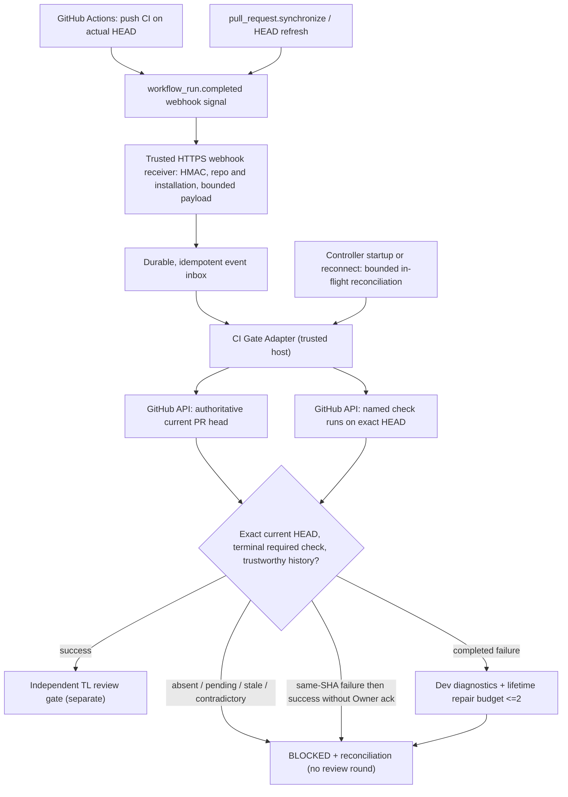

# V1-03 — Exact-SHA GitHub CI Gate: Plan / AC v0.1 (DRAFT)

**Status:** TL Planner draft; **NOT** a reviewed/Owner-approved package, MTP or Dev dispatch authorization.
**Date:** 2026-11-09
**Baseline:** `main@96f5d523814f94ebfec244c66e38d400e2144509`
**Notion:** [V1-03 task](https://app.notion.com/412f92014abd810db405e868e96db6da)
**Authority:** [V1 scope and gates](../v1-scope-and-gates.md). Owner's CI-first and webhook-based CI completion decisions are documented in V1-03 Notion.
**Related:** [Merged CI bootstrap PR #26](https://github.com/builacviet/agent-workflow/pull/26), [Merged V1-02 role docs PR #27](https://github.com/builacviet/agent-workflow/pull/27), [separately in-progress Sandbox PR #31](https://github.com/builacviet/agent-workflow/pull/31).

## What is actually finished and what is not

**Existing:** `.github/workflows/v1-ci.yml` triggers branch `push` (checks actual commit HEAD) and `pull_request` (checks synthetic merge commit), installs/test/compiles on Python 3.11, has read-only contents permission, and no automatic merge. It is already merged and must **not** be rebuilt.

**Still NOT implemented:** A trusted webhook receiver/durable CI event inbox; Controller exact-current-PR-HEAD authoritative-check adapter; fail-closed state transitions and audit/counters; recovery for missed/duplicate/stale events. PR #31's sandbox changes do not implement these gates. Do not conflate a GitHub successful run with an implemented Controller CI gate.

## Architecture / boundaries

The webhook is a notification **only**, never an authoritative PASS. No incoming event can authorize merge, advance stale SHA, or consume a TL/QC round. CI counter, plan counter, code-review counter, QC counter are independent.

## Atomic planning packages — independence and allowed paths

The following are **proposed** tasks under existing V1-03. Each is `qc: required` because CI identity/state affects authorization; QC Codex must prepare its own AC-traceable pre-Dev MTP. The current implementation has no new approved task dispatch.

### V1-03A — Trusted exact-HEAD check verifier (independent preparation)

**Depends on:** V1-01 (Done), merged CI workflow PR #26. **Does not depend on V1-02 or PR #31 for an isolated API adapter and fixtures.**

**Suggested allowed paths** (Codex Lead to check/freeze before a reviewed package): new `src/agent_workflow/integrations/ci_checks.py`, new `tests/test_ci_checks.py`. No Controller or sandbox edits.

**AC:**
1. Given trusted repo/installation and PR ID, independently fetch current PR head and required named check (`Python tests` from current workflow) on the **actual branch HEAD SHA**; a green `pull_request` synthetic merge SHA is not sufficient.
2. Validate repo/installation/check identity and the check's tested SHA, event, run attempt, run/check IDs, completed timestamp; return typed evidence with `task_id`, `current_pr_head_sha`, `tested_sha`, named check, event and conclusion. Record exactly which fields are observed vs inferred.
3. Missing, pending, cancelled, timed out, neutral, skipped, failing, stale, mismatched and ambiguous results cannot produce `PASS`. A completed named failure is a distinct `FAILED` result carrying bounded actionable diagnostics, **not** a code-review submission. Never trust an LLM-composed URL or event body as API authority.
4. Retest races: PR head changes between fetches; re-query and reject inconsistent snapshots. Duplicate or conflicting check history and same-SHA failed-then-success without Owner audit authorization remain `BLOCKED`.
5. Deterministic fixtures prove green branch-HEAD vs green merge SHA, failing/pending/missing/stale, wrong repo, race, and same-SHA rerun conflict. No live token required.

**DoD:** contract and tests can run offline against mocked GitHub responses; never claim tested live GitHub authentication unless separately granted.

### V1-03B — Webhook validation and durable event inbox (independent preparation)

**Depends on:** V1-01 and V1-03A contract agreement. **No dependence on PR #31 for an isolated receiver and fixture tests.**

**Suggested allowed paths:** new `src/agent_workflow/integrations/github_webhook.py`, isolated `src/agent_workflow/storage/ci_event_inbox.py` and new tests for webhook/inbox; any schema or existing public server modification requires explicit reviewed changed-path expansion, not an implicit MCP modification.

**AC:**
1. Before accepting any event, reject oversized bodies; validate raw-body `X-Hub-Signature-256` with a secret held outside source/logs, repo and installation identity, event/action allowlist. Never reuse MCP Bearer auth as webhook authorization.
2. Accept only bounded `workflow_run.completed` and PR-head refresh events; persist the accepted delivery ID + minimal event identity durably and idempotently **before** 2xx; reject/ignore replay and duplicates without advancing a gate.
3. Invalid HMAC/repo, forged payload, stale/duplicate/out-of-order deliveries do not change the approved current SHA or grant PASS. No direct trust in conclusion of webhook payload.
4. Restart/replay test: accepted event survives worker restart, duplicate does not create a second transition, no secrets or prompt logged.

**Deployment gate:** Do **not** enable a public HTTPS listener, subscribe GitHub App events, mutate permissions, or reuse existing tunnels until Owner authorizes stable ingress and webhook secret provisioning. Offline implementation and tests do not satisfy live delivery AC.

### V1-03C — Durable Controller CI gate, repair budget and reconciliation (integration later)

**Depends on:** V1-03A/B reviewed contracts, and resolution/integration of PR #31 to avoid editing conflicting `src/agent_workflow/orchestration/controller.py` concurrently.

**Suggested allowed paths (after approval):** `src/agent_workflow/orchestration/controller.py`, dedicated CI gate service/dispatch persistence, narrow additive storage migration/test files. Preserve existing MCP nine tools and existing trusted host Docker pattern.

**AC:**
1. The Controller advances to independent TL only after an authoritative exact-HEAD named-check success *and* other existing gates. Any changed PR HEAD invalidates previous CI evidence.
2. CI `FAILED` yields Dev-actionable bounded diagnostics without using a TL/QC review round. Missing/pending/stale/inconclusive => `BLOCKED` and reconciliation, not a repair attempt.
3. **Max 2 Dev CI-repair HEAD attempts per task lifetime** across original Dev, code-review fixes, QC repairs; only attempted new repair HEADs count. Same-SHA rerun cannot silently override a prior completed failure; it stays BLOCKED until an audited Owner acknowledgement. No third automatic repair, no hidden reset per session.
4. Durable event inbox and source-of-truth check/audit bind task ID, PR URL, exact SHA, check name, event, conclusion, workflow run ID, run attempt, check run ID, completion timestamp, and gate decision. Duplicate, late, reordered webhook signals remain idempotent.
5. On Controller startup/reconnection, bounded reconciliation targets **only in-flight CI tasks**. No routine 60-second global polling and no reliance on uninterrupted Windows/WSL2 connectivity.
6. Tests prove green branch HEAD, stale evidence after new HEAD, a completed failed run, two repair HEAD budget exhaustion, counter independence, same-SHA rerun conflict, lost/double/reordered events, crash-restart recovery and no owner-gate bypass.

**DoD:** effective state-machine tests and exact-HEAD event history; CI gate cannot self-approve code review or Owner merge. Live external webhook/credentialed tests require separate authorization and evidence.

## Sequencing and change-control

1. **NOW:** TL Planner drafts this Plan/AC v0.1 as docs only; V1-03 remains `In Progress` but **Owner Gate Pending**. Review independently before Dev dispatch.
2. **While PR #31 code is parked:** independently prepare/review A's verifier and B's receiver contract/fixtures; **do not** edit overlapping Controller, deployment config or production ingress.
3. **After PR #31 resolution:** integrate C with the Controller and durable state transitions. Any collision with PR #31's changed HEAD requires explicit rebase and new exact-HEAD tests.
4. QC produces an independent MTP for each `qc: required` atomic task; Independent TL reviews the package; Owner approves immutable package; only then Dev dispatches in the approved **sequential** task order.
5. On code PRs: trusted publish → exact-HEAD CI → independent TL → required QC → Owner-specific merge approval. No automatic merge, no parallel production execution.

## Risks / explicit blockers

- Owner-approved stable HTTPS ingress path and GitHub App event subscription remain unprovisioned: this blocks **live webhook acceptance evidence**, not drafting offline exact-SHA adapter tests.
- A green GitHub Actions check `Python tests` **on branch HEAD** is necessary but not equivalent to branch-protection/Owner merge authorization.
- Preserve CODEX native sandbox and any vendor-independent runtime contract unaffected; do not call Codex/AGY/Claude/OpenCode or touch secrets for this docs-only scope.
- Model/effort from V1-02 and sandbox credential isolation from PR #31 remain separately blocked; no implicit gate waiver or third historical V1-02 review.
