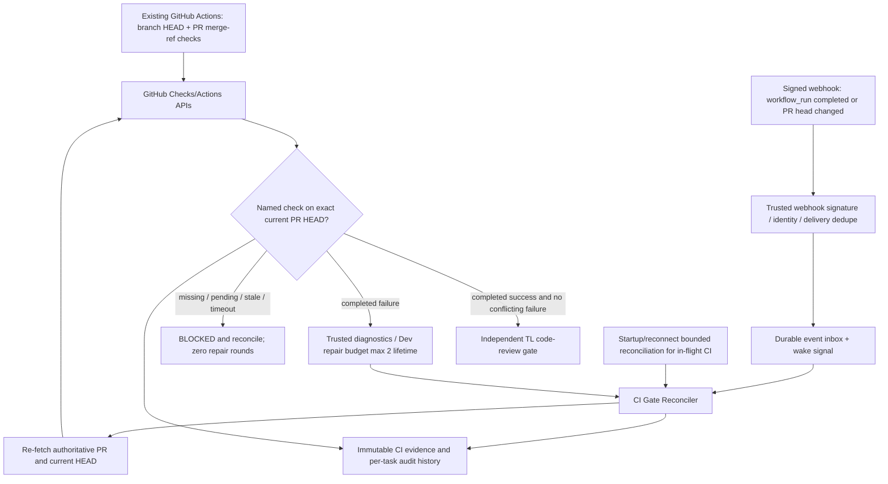

# V1-03 — Exact-SHA CI Gate and Webhook Signal: implementation Plan v0.1

**Status:** DRAFT / TL Planner proposal. No Plan/MTP independent-review approval and no authorization for Dev dispatch, live HTTPS ingress, credential use, production workflow modifications or merge.
**Date:** 2026-11-09
**Base:** `main@96f5d523814f94ebfec244c66e38d400e2144509`
**Notion source:** [V1-03 — GitHub Actions CI and Exact-SHA Gate](https://app.notion.com/412f92014abd810db405e868e96db6da)
**Governing scope:** [V1 gate contract](../v1-scope-and-gates.md) (Owner-approved via PR #22)
**Already merged:** [CI workflow bootstrap PR #26](https://github.com/builacviet/agent-workflow/pull/26). `push` runs at actual branch commit; `pull_request` also runs at GitHub's synthetic merge commit. **Do not rebuild these workflows**.
**Concurrent foundation work:** [Draft PR #31](https://github.com/builacviet/agent-workflow/pull/31) touches `src/agent_workflow/orchestration/controller.py` and runtime modules and is not merged. This Plan is documentation-only and may proceed now. Integration must rebase and re-evaluate after PR #31's review/merge or other Owner direction.

## Executive decision

**Do now (without runtime/code conflict):** freeze a versioned CI evidence contract, AC, deterministic negative test cases, source/ownership boundaries and review handoff. Later, **once a separately reviewed and approved package authorizes coding**, a CI-query/decision module can be implemented offline on its own worktree, without changing Controller or webhook ingress.

**Do not do in this docs task:** open any external port, change GitHub App subscriptions/scopes, mount real secrets, change Docker/Controller, create a polling engine, assume a webhook payload is authoritative, or dispatch any V1-02 Dev task.

## Architecture (TARGET; not yet implemented)

**Trust boundary:** webhook payload is a notification only. The trusted CI adapter must independently query the current PR HEAD and exact-SHA check/check run. A successful check on GitHub's synthetic PR merge SHA is **not** proof of success on branch HEAD.

## Shared ngrok domain — Owner-approved V1-03B direction (2026-11-09)

The Owner accepts reusing the **existing public ngrok hostname** for both the current MCP endpoint and the future GitHub webhook endpoint. This is **authorization to document the intended architecture only**; it does **not** authorize running a public listener, changing the current tunnel/GitHub App configuration, or production deployment.

- Existing Compose `compose.yaml` and `compose.controller.yaml` direct the ngrok tunnel to `mcp:8000`; default configured hostname is `caddy-reopen-scotch.ngrok-free.dev`, controlled by `NGROK_DOMAIN`. The MCP route is already `https://<NGROK_DOMAIN>/mcp`.
- **Target routes on the same HTTPS origin:** `/mcp` → existing MCP handler unchanged; `/webhooks/github` → a **separate trusted webhook receiver**. A minimal path router/reverse proxy (or equivalent ingress path-routing capability, selected in V1-03B) is required **before** enabling the second route because the current ngrok tunnel forwards all paths to MCP. Do not assume merely adding a URL in GitHub App creates the route.
- **Isolation:** preserve the existing MCP OAuth/auth/Host protections and all nine tool contracts. The webhook route must **not** be an unauthenticated bypass into `/mcp`, Controller admin endpoints, Docker or worker APIs. Its dedicated trust mechanism is GitHub HMAC signature validation; it is not subject to browser/MCP OAuth credentials.
- **Webhook verification:** `POST /webhooks/github` must validate raw request bytes using `X-Hub-Signature-256` (HMAC-SHA256 with a dedicated secret, constant-time compare), enforce method and bounded body size, `X-GitHub-Event`/action allowlist, repository and installation identity and duplicate/replayed `X-GitHub-Delivery` handling. Only acknowledge `2xx` after accepted event persistence; invalid signature/auth must be rejected, not enqueued. Do not log secrets, payload credentials or raw signature.
- **Operational constraints:** no second ngrok tunnel/domain required by this design, **provided** chosen ingress permits secure path routing. Confirm the current ngrok account's tunnel routing compatibility and the active hostname before deployment. Avoid interrupting existing `/mcp`; no `docker compose down -v`, no reuse of public MCP login as webhook trust.
- **Proof before live enablement:** tests demonstrate signed delivery reaches **only** receiver, unsigned/tampered payload is rejected, `/mcp` continues authenticated and unchanged, wrong path/method cannot invoke privileged routes, duplicates are idempotent, and network interruption triggers bounded in-flight CI reconciliation. Separate explicit Owner approval is still required for live HTTPS ingress changes, webhook secret provisioning, GitHub App subscription and deployment.

**Event semantics unchanged:** GitHub emits a notification, not an authoritative CI decision. The verifier re-queries GitHub for the **current** PR HEAD and required exact-SHA checks. Old SHA evidence is marked stale and does not block waiting for the new HEAD or consume a repair/review round.

## Contract v1 (proposed, only source-of-truth candidate)

CI evidence is an immutable record containing:
- `task_id`, `pr_number`, `repository`, `current_pr_head_sha`, `tested_sha`;
- expected `check_name`, `event` and check conclusion/status; `workflow_run_id`, `run_attempt`, `check_run_id`, `completed_at`;
- trusted retrieval timestamp, installation/repository identity, and a decision `SUCCESS | FAILURE | BLOCKED` with reason;
- the name of the *actual* GitHub check source, not an agent-authored "tests passed" string.

The record must bind to the exact **latest** PR head at decision time. Old SHA results do not authorize progress. Missing, queued, pending, cancelled, timed_out, stale, mismatched or ambiguously duplicated evidence is `BLOCKED`, never success. Retain history even if the same SHA is rerun.

**Repair policy (Owner decision in V1-03 Notion):** maximum **two Dev CI repair HEAD attempts per `task_id` lifetime**, independent of TL-review and QC repair counters. A completed failure is actionable, but is **not itself** a repair attempt; count the subsequent attempted repair HEAD. Neither an automatic third repair nor a per-session/commit quota reset is allowed. A previously failed required check on the **same SHA** followed by successful rerun must be `BLOCKED` pending audited Owner acknowledgment; a same-SHA rerun is not a repair HEAD.

## Proposed atomic implementation slices (NOT dispatched)

### V1-03A — Offline exact-SHA evidence verifier / decision contract

**Dependencies:** V1-01 done, PR #26 merged. Does not require PR #31 to design or implement offline **after planning-gate approval**.

**Candidate owned paths:** `src/agent_workflow/integrations/ci_gate.py` (new), `tests/test_ci_gate.py` (new). Avoid editing `controller.py`, `coder_runtime.py`, Dockerfiles, workflow YAML, persistence schema and secrets. The Lead freezes imports and exact changed paths.

**AC (QC: required):**
- A1 — Validate trusted input: repo/installation/pr/head/check identity, strict SHA, schema and check-name allowlist.
- A2 — Query API through injected read-only transport; verify PR's latest head and matching *actual branch HEAD* check-run. Treat webhook/PR synthetic merge-ref evidence as non-authoritative.
- A3 — `SUCCESS` only with completed named success for exact current SHA and no unacknowledged conflicting same-SHA failure. `FAILURE` only for verified completed failure on the required named check; all unknown/missing/pending/stale/cancelled/timeout/API errors fail closed to `BLOCKED`.
- A4 — Expose a deterministic, serializable evidence outcome without advancing any workflow gate, reviewer round, Owner approval, or repair counter.
- A5 — Unit fixtures prove positive + negative transitions, re-query after HEAD changes, same-SHA failed-then-successful rerun conflicts and untrusted webhook false-PASS.
- A6 — Full repo offline regression passes at exact HEAD; no credentials/remote GitHub calls required for test suite.

**DoD:** independent QC MTP against A1–A6, reviewed Plan/AC, exact HEAD test/CI evidence, independent TL code review and Owner merge decision. Mocked API is *not* live webhook proof.

### V1-03B — Durable webhook receiver, reconciliation and Controller gate wiring

**Dependencies:** V1-03A contract reviewed/merged; PR #31 Controller overlap resolved; stable ingress route and GitHub App subscription/permission changes require separate Owner task-specific authorization. No code dispatch under this draft.

**Candidate future paths** (not approved now): trusted webhook handler and persistence, controller CI-gate integration, dedicated tests. Avoid breaking any of the existing 9 MCP tool contracts.

**AC (QC: required):**
- B1 — Validate raw-body `X-Hub-Signature-256` HMAC (constant-time compare); restrict event/action/repo/installation identity; limit payload size; block unauthorized requests without parsing secrets into logs.
- B2 — Durable, replay/duplicate-safe delivery ID tracking *before* 2xx acknowledgment. Reject or safely handle reordered `workflow_run.completed` and `pull_request.synchronize` events. Do not use `on: workflow_run` to chain CI.
- B3 — The event wakes a trusted reconciler that re-queries latest PR HEAD and named check; never grant PASS from event alone.
- B4 — Integrate clear `BLOCKED` vs completed `FAILURE` vs `SUCCESS` state transitions and the two-repair-HEAD lifetime budget, independently of the two TL review rounds and QC repairs. No global polling on a 60-second timer.
- B5 — Restart/reconnect reconciles only in-flight CI; tests cover lost/duplicate/out-of-order/stale events and fail-closed missing API evidence.
- B6 — Preserve existing 9 MCP tools, single-slot Controller and no unapproved ingress or secrets; stage safe runbook for Owner approval before live event subscriptions.
- B7 — Reuse the existing configured ngrok HTTPS hostname with **path-based routing**: authenticated existing `/mcp` and HMAC-authenticated `/webhooks/github` on separate handlers. Verify protected route isolation, raw-body signature enforcement, and zero existing MCP contract/auth regressions before any live route change. The existing tunnel currently targets only `mcp:8000`; a minimal ingress router is a prerequisite.

## Evidence-based negative tests

| Case | Fixture | Expected decision |
| --- | --- | --- |
| C01 | Matching current HEAD, completed required success, no conflicts | SUCCESS |
| C02 | Required check absent / queued / in progress | BLOCKED |
| C03 | Check on prior PR HEAD | BLOCKED |
| C04 | Success only on synthetic PR merge SHA | BLOCKED |
| C05 | Required check completed failure | FAILURE; Dev diagnostic, no TL round |
| C06 | Failed required check then success rerun on same SHA without Owner acknowledgment | BLOCKED |
| C07 | Cancelled, timed out, unknown check conclusion or API error | BLOCKED |
| C08 | Spoofed webhook `success` while API has no evidence | BLOCKED |
| C09 | Duplicate delivery ID, lost event, reverse event order | Idempotent, reconcile |
| C10 | Third Dev repair HEAD for same task lifetime | Denied / Owner escalation |
| C11 | Invalid/missing `X-Hub-Signature-256`, modified body, wrong method | Reject before persistence; no Controller action |
| C12 | Valid signed webhook at `/webhooks/github`, existing `/mcp` request | Each reaches only its own handler; MCP auth and nine tools unchanged |

## Owner and review gates

- `V1-03` Notion remains **In Progress**, **Owner Gate Pending**. This document is a **planning proposal**. Neither slice is implementation-authorized by merely being listed.
- V1-02 Plan/MTP remain ESCALATED / BLOCKED; PR #30 and PR #31 remain Draft. Never infer V1-03 readiness from their CI results.
- No independent QC MTP or Independent TL planning review is claimed for this proposal. The next authorization step is a separately reviewed planning package bound to exact version/hash, then Owner approval. An approved Plan does not approve subsequent PR merges.
