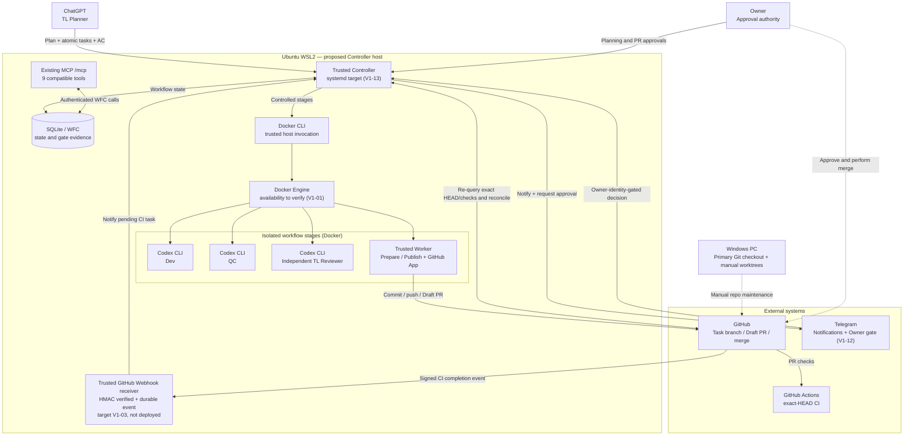
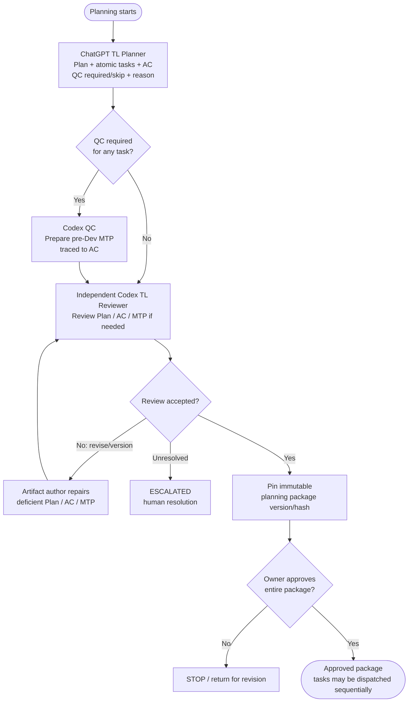
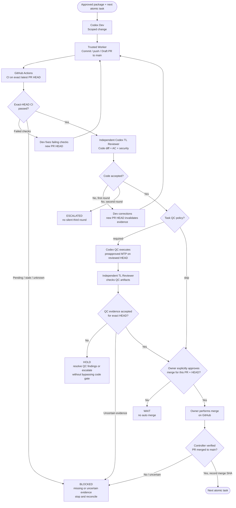

# Agent Workflow V1 — Visual Architecture & Workflow

> **Design status:** V1 scope is Owner-approved ([PR #22](https://github.com/builacviet/agent-workflow/pull/22), [scope clarification PR #23](https://github.com/builacviet/agent-workflow/pull/23)). Diagrams show the **target V1 flow**, not evidence that all steps are deployed.
>
> **Target host:** Owner's **Ubuntu on WSL2 / Windows**. Linux/systemd/Docker access, credential readiness, WSL2 start/restart behavior and 24/7 availability remain to be verified in **V1-01**; systemd deployment is in **V1-13**.
>
> **Out of V1:** Executor, Podman, Controller-to-Executor IPC, epic/parallel branches, auto-merge.

## 1. System architecture (target V1)

**Webhook signal:** GitHub emits a signed `workflow_run.completed` notification; the receiver validates and durably records it. Controller must re-query GitHub's **current PR HEAD** and named exact-HEAD checks before advancing. After WSL2 sleep/restart, reconcile in-flight CI tasks to recover missed notifications; do not poll every 60 seconds as the primary mechanism. Webhook/adapter are **not yet implemented**.

**Trust boundary:** Only the **trusted Controller** invokes the existing Docker CLI, and only the **trusted publishing Worker** uses GitHub App credentials. Untrusted Codex stages do not receive GitHub secrets, WFC database, arbitrary host paths or Docker engine access. The host Docker authority is broad and remains an acknowledged risk, **not** proof of production isolation. Diagram edges are design intent, not verified installed integrations.

## 2. Planning — one Owner approval for a complete package

Owner **planning approval does not authorize automatic PR merges**. Changed approved content must be reviewed and approved again. Unresolved plan revisions escalate rather than looping indefinitely.

## 3. Execution — sequential atomic PR and exact-SHA gates

**Failure semantics:** Infrastructure uncertainty is **BLOCKED** and does not consume a code-review round. Two **failed code reviews** mean **ESCALATED**. A changed PR HEAD invalidates earlier CI/review/QC approvals; fresh checks and applicable review are required. QC failures do not silently authorize a third code-review round. No parallel task dispatch or automatic merge.

## 4. Where to read next

- [V1 Scope & Gate Contract](v1-scope-and-gates.md): authoritative detailed rules.
- [Current Phase 3.1 architecture](architecture.md) and [runbook](phase-3.1.md): what is presently implemented, **not** proof of WSL2 deployment.
- [Notion V1-01 readiness task](https://app.notion.com/412f92014abd812486e2f8a7e3145850): verify the Ubuntu WSL2 environment and startup availability.
- [Notion V1 backlog](https://app.notion.com/p/ad495e0645a74aebb326d29c1818ede7): execution order and Owner gates.
